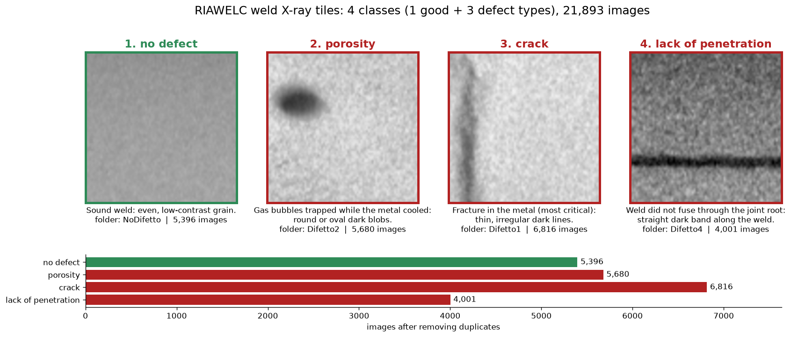
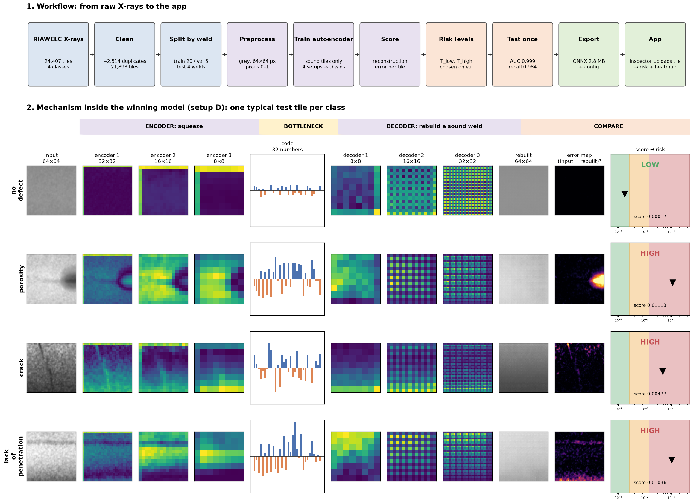
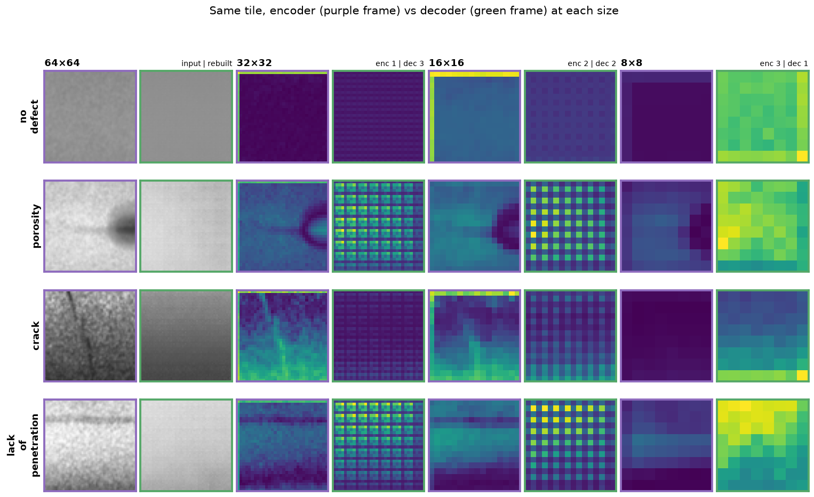
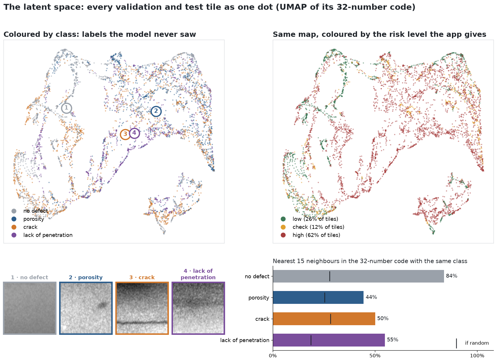
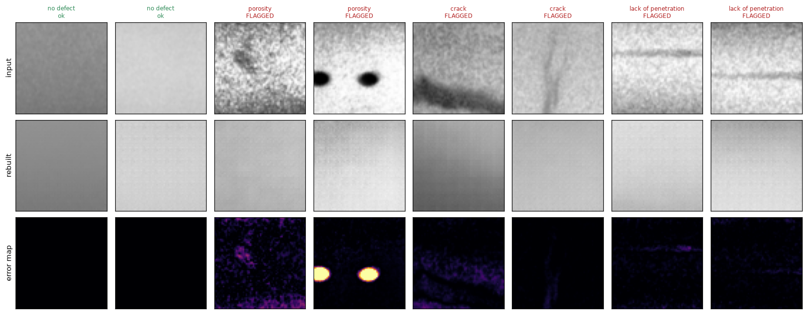
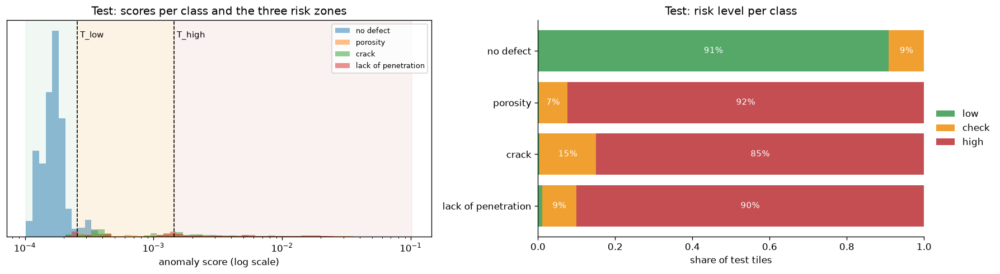

# 01 · Autoencoder for weld anomaly detection

## Use case

A weld inspector uploads X-ray tiles of steel welds. The app flags suspicious areas and ranks each tile **low / check / high** risk, so the inspector reviews the riskiest welds first.

- **How:** a convolutional autoencoder learns what a sound weld looks like from defect-free tiles only. Tiles it cannot reconstruct well (high reconstruction error) are anomalous; the error map shows *where*.
- **Risk levels:** two thresholds on the anomaly score, chosen on validation data to catch most defects, because a missed crack costs far more than a false alarm.
- **What it is not:** a certified accept/reject decision. Acceptance under standards such as ISO 5817 depends on defect type, size and plate thickness, which the dataset does not provide. The tool is a screening aid; a qualified inspector decides.

## Dataset

| | |
|---|---|
| **Name** | RIAWELC weld radiographs |
| **Source** | https://github.com/stefyste/RIAWELC |
| **Size** | 24,407 greyscale PNG tiles of 227 × 227 px (the dataset README says 224; the files are 227), cut from X-rays of 29 welds |
| **Classes** | no defect (`NoDifetto`), porosity (`Difetto2`), crack (`Difetto1`), lack of penetration (`Difetto4`): mapping confirmed visually |
| **Cleaning** | 2,514 duplicates removed (every original test image was also in training) → **21,893 unique tiles** |
| **Split** | New split **by weld**, so no weld appears in two splits: train 20 welds, validation 5, test 4 |
| **Used** | Training: the **3,783 no-defect tiles** of the training welds only. Validation: 2,788 tiles (747 sound + 2,041 defects). Test: 3,019 tiles (866 sound + 2,153 defects) |
| **Licence** | No formal licence; free with citation (see the root README). Not redistributed. |

## How to run

```bash
python -m venv .venv
.venv\Scripts\activate           # macOS/Linux: source .venv/bin/activate
pip install torch==2.14.1 torchvision==0.29.1 --index-url https://download.pytorch.org/whl/cu130   # NVIDIA GPU; CPU: .../whl/cpu
pip install -r requirements.txt
git clone https://github.com/stefyste/RIAWELC data/RIAWELC
# then extract data/RIAWELC/Dataset_partitioned/RIAWELC_dataset.part01.rar into data/riawelc_extracted/ (see CONTRIBUTING.md)
```

Open `notebook/autoencoder.ipynb`, select the `.venv` kernel and run all cells. Training ran on an **NVIDIA RTX 5080 Laptop GPU**: 3–12 s per setup, about 2 minutes for the whole notebook. On a CPU it works too, just slower. Results are reproducible: the same seed gives the same numbers on every run.

The notebook writes the model files to `model_app/` (`anomaly_ae.onnx`, `anomaly_ae.pt`, `anomaly_ae_config.json`, example tiles). The `.onnx`/`.pt` files and the example tiles are git-ignored: the model goes to Hugging Face, and the dataset must not be re-uploaded.

## Setups compared

All setups trained on the same no-defect tiles, with the same split, seed and recipe (Adam, batch 64, random flips, early stopping on validation). Errors are the mean reconstruction error (MSE) of **sound** tiles. ROC AUC measures how well the error separates defects from sound tiles. Precision and recall are on the test set at the 95% threshold (95th percentile of sound validation errors). **The winner was chosen on validation ROC AUC only.**

| Setup | Parameters | Training time | Validation error | Test error | ROC AUC (val / test) | Precision | Recall |
|---|---|---|---|---|---|---|---|
| A: Conv AE, 128 px, latent 32 | 1,014,049 | 11 s | 0.00027 | 0.00023 | 0.987 / 0.998 | 1.000 | 0.964 |
| B: Conv AE, 128 px, latent 128 | 2,587,009 | 6 s | 0.00038 | 0.00031 | 0.986 / 0.999 | 1.000 | 0.967 |
| C: Dense AE, 128 px, latent 32 | 16,827,424 | 3 s | 0.00035 | 0.00025 | 0.977 / 1.000 | 1.000 | 0.972 |
| **D: Conv AE, 64 px, latent 32** | **718,369** | **8 s** | **0.00020** | **0.00018** | **0.990 / 0.999** | **0.994** | **0.984** |
| Baseline: contrast only (no model) | – | – | – | – | 0.946 / 0.936 | 0.926 | 0.879 |

ROC AUC per defect type on validation:

| | Porosity | Crack | Lack of penetration |
|---|---|---|---|
| A | 0.992 | 0.980 | 0.997 |
| B | 0.992 | 0.979 | 0.997 |
| C | 0.987 | 0.966 | 0.992 |
| **D** | **0.994** | **0.985** | **0.998** |
| Baseline | 0.949 | 0.926 | 0.991 |

**Conclusion:** **setup D wins**: the smallest model has the best validation AUC overall and for every defect type, and the best recall.
- **64 px beats 128 px.** The lower resolution averages away the X-ray grain, which an autoencoder cannot copy anyway, while the defects survive the resize.
- **A bigger code (B) does not help.** More room in the bottleneck lets the model copy defects too.
- **The dense model (C) is worst**, with 17× more parameters. It ignores which pixels are neighbours, so it is worse at telling shapes from grain.
- **Every autoencoder beats the contrast baseline**, most of all on **cracks** (0.985 vs 0.926). The model learns more than "defects are high contrast".
- **Cracks are the hardest defect** for every setup: thin, faint, few pixels.
- **Test is easier than validation** (only 4 welds), so the fair claim is **"about 0.99 AUC on unseen welds"**. The gap between A and D is within that uncertainty.

## Results

### The four classes



### How the model works

The autoencoder squeezes a 64 × 64 tile into **32 numbers** and rebuilds it. It only ever learned sound welds, so it rebuilds every tile as a sound weld: the defect is missing from the rebuilt tile, and the **error map** (input − rebuilt)² lights up exactly there.



The encoder still "sees" the defect at every size; the decoder never draws it:



### The latent space

Each tile's 32-number code, squeezed into 2D with UMAP (validation and test tiles, 5,807 dots):



- **Sound welds group together:** 84% of a sound tile's nearest neighbours in the code are also sound (28% by chance).
- **The defect types don't separate from each other:** 44–55% (19–28% by chance). The model was never asked to tell them apart.
- **The code mostly describes how the X-ray looks:** 60% of neighbours come from the same weld (14% by chance). It stores brightness and grain, which is what's needed to redraw a sound weld; the defect is what it leaves out.
- **Detection comes from the reconstruction error, not from the position on the map.**

### Test set (4 unseen welds), setup D

- **ROC AUC 0.999**, precision 0.994, recall 0.984 at the 95% threshold
- Flagged: **98.6%** of porosity, **97.8%** of cracks, **98.6%** of lack-of-penetration tiles, and only **1.5%** of sound tiles



### Risk levels: low / check / high

Two thresholds, both chosen on validation:
- **T_low = 0.000255:** 98% of validation defects score above it. Safety first: a missed crack costs more than a false alarm.
- **T_high = 0.001442:** only 0.5% of sound validation tiles score above it.

| Test tiles | 🟢 low | 🟠 check | 🔴 high |
|---|---|---|---|
| no defect | **90.9%** | 9.1% | 0.0% |
| porosity | 0.2% | 7.4% | **92.4%** |
| crack | 0.3% | 14.7% | **84.9%** |
| lack of penetration | 1.1% | 8.8% | **90.1%** |

Only **11 of 2,153 defect tiles (0.5%)** end up in "low", and **91% of sound tiles** can be skipped.



### What the output means for a user

> *The score says how unlike a sound weld this X-ray tile looks. The risk level says whether an inspector can skip it, should check it, or should check it first, and the error map shows where to look.*

The exported ONNX model (2.8 MB) gives the same scores as PyTorch, and the thresholds are in `model_app/anomaly_ae_config.json`.

## Model on Hugging Face

**[iaac-maai/hackathon-team1-weld-anomaly-ae](https://huggingface.co/iaac-maai/hackathon-team1-weld-anomaly-ae)**: `anomaly_ae.onnx`, `anomaly_ae.pt`, `anomaly_ae_config.json` and a model card with usage code. The card's source is [model_app/MODEL_CARD.md](model_app/MODEL_CARD.md).

```python
from huggingface_hub import hf_hub_download
onnx_path = hf_hub_download("iaac-maai/hackathon-team1-weld-anomaly-ae", "anomaly_ae.onnx")
```

## Slides

[slides/weld_anomaly_tuesday_slides.pdf](slides/weld_anomaly_tuesday_slides.pdf): the Tuesday deck in one PDF, 6 pages (cover, dataset and setups, the full comparison table, what we see, the latent space, the app idea).

## Limitations

- **Few welds:** 29 in total, 4 in the test set. The test score (0.999) partly depends on which welds landed there; "about 0.99 on unseen welds" is the fair claim.
- **One lab, one X-ray setup:** results may not transfer to other equipment or exposure settings.
- **Tile-level labels:** each tile has one label for the whole tile, so we can check whether a tile is flagged, but not whether the error map points at the right spot.
- **Texture, not only defects:** the model rebuilds every tile as a smooth grey gradient. On very grainy X-rays part of the score comes from the grain.
- **Noisy training curves:** setups B and C stopped early (epochs 5–6) and may be slightly under-rated.
- **Screening aid, not a verdict:** acceptance under welding standards (e.g. ISO 5817) depends on defect size and plate thickness, which the dataset does not contain. A qualified inspector decides.

## Next experiments

From section 14 of the notebook, the top three:
1. **Repeat with other seeds and weld splits** (cross-validation by weld): is D really better than A?
2. **A better anomaly score:** the peak of the error map instead of its average, so thin cracks are not diluted.
3. **Error analysis:** look at the 11 missed defects and the false alarms.
