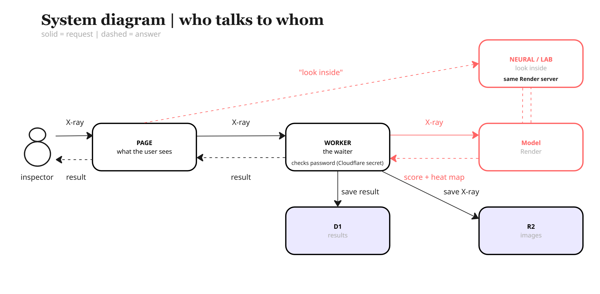
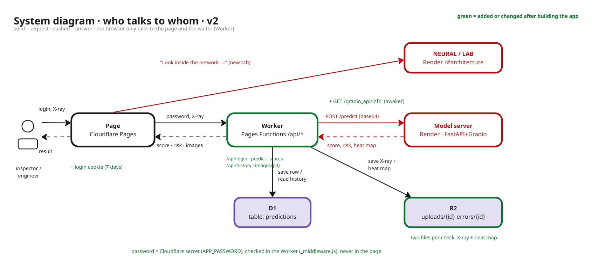

# 03_app · NEURAL / LAB · Inspect

**Live app:** https://hackathon-team1-weld-app.pages.dev

A password-protected web app for weld inspectors. You upload an X-ray tile of a weld; our model (a convolutional autoencoder that learned only from good welds) tries to redraw it. Where it can't, the error map lights up. The app shows a risk level (**LOW / CHECK / HIGH**), the score against the two thresholds, and three images side by side: the uploaded X-ray, the model's redraw and the error heat map. It saves every check so it is still there after a reload. A button opens **NEURAL / LAB · Look inside** (on Render) with **the same X-ray**, so you can see how the network handles it.

It is a screening aid, not a verdict: a qualified inspector decides.

## How to log in

Two steps, both on the login page:
1. **The shared team password.** It is given in the course hand-in, **not** in this repository. It is stored as a Cloudflare secret (`APP_PASSWORD`) and checked on the server, never in the page. It is asked at every log-in and sign-up, so nobody gets in without it.
2. **Your own account:** a username and your own password (at least 8 characters). The first time, press **Create account**. **Each user sees only their own checks** (history and images).

Passwords are never stored: D1 keeps only a salted PBKDF2 hash. After log-in, a signed session cookie (HttpOnly, 7 days) names the user; it can't be edited into another user's id.

> The model server on Render sleeps after 15 minutes without use. The first check after a pause can take about a minute: the app shows "Model is waking up, about 1 minute…" and retries by itself, without showing an error.

## How it works

| Part | Service | What it does |
|---|---|---|
| **Page** | Cloudflare Pages (`public/`) | Plain HTML, CSS and JavaScript: the login page, upload, result and recent checks |
| **Worker** | Pages Functions (`functions/`, `lib/`) | `_middleware.js` checks the session cookie on every request and passes the user on. `/api/login` (team password, then log in or create an account), `/api/logout`, `/api/me` (who is logged in), `/api/predict` (checks the file, calls the model, saves the result), `/api/history` (last 20 checks), `/api/images/{id}` (an image from R2), `/api/status` (is Render awake?), `/api/shared/{id}` (one X-ray for NEURAL / LAB, with a signed link instead of the cookie) |
| **Model server** | Render | Our FastAPI + Gradio server (`02_model_server/`). The Worker calls its `/predict` API at `MODEL_URL` with the image as base64 and gets back the score, risk level, redraw and error map |
| **Database** | Cloudflare D1 (`hackathon-team1-weld-db`) | Table `users`: one row per account (`id`, `username`, `password_hash`, `created_at`). Table `predictions`: one row per check (`id`, `created_at`, `file_name`, `score`, `threshold`, `is_anomaly`, `risk_level`, `score_vs_threshold`, `image_key`, `user_id`). See `schema.sql`; `migrations/0002_users.sql` added the accounts to the live database. Checks saved before accounts existed have no owner and are no longer shown |
| **File storage** | Cloudflare R2 (`hackathon-team1-weld-images`) | The uploaded X-ray (`uploads/{id}`) and its error heat map (`errors/{id}`). D1 keeps the key; R2 keeps the file |
| **Password** | Cloudflare secret | `APP_PASSWORD`, set with `npx wrangler pages secret put APP_PASSWORD` |

**Why these services:** Render runs our Python model; Cloudflare runs the small, fast server code next to the page and has a database (D1) and file storage (R2) built in. Only the Worker talks to the model, the database and the files, so the password and the model address stay on the server.

**Safety:** the Worker only accepts real PNG or JPEG files (it checks the file's first bytes, not its name), up to 5 MB. User input never goes into SQL text (`?` placeholders). **Own data only:** `/api/history` returns only the logged-in user's rows, and `/api/images/{id}` answers "Not found" for another user's image. A wrong username and a wrong password get the same message, so the login doesn't reveal which usernames exist. The only thing reachable without the password is one X-ray through a signed link (`/api/shared/{id}`), which expires after 24 hours and stops working if the id or the expiry is changed.

## Diagrams

On our Miro board, exported in two sets:

| | [1 · Before the app](diagrams/1_before_the_app) (the design) | [2 · After the app](diagrams/2_after_the_app) (what we built) |
|---|---|---|
| 2 user stories (the inspector, the engineer) | [user stories](diagrams/1_before_the_app/user_stories.png) | same stories |
| System diagram | [system](diagrams/1_before_the_app/system.png) | [system](diagrams/2_after_the_app/system.png) |
| D1 table | [example rows](diagrams/1_before_the_app/d1_table.png) | [real columns](diagrams/2_after_the_app/d1_table.png) |
| Sequence: check a weld (story 1) | [check a weld](diagrams/1_before_the_app/sequence_1_check_a_weld.png) | [step by step](diagrams/2_after_the_app/sequence_1_check_a_weld.png) |
| Sequence: look inside the network (story 2) | [look inside](diagrams/1_before_the_app/sequence_2_look_inside.png) | [step by step](diagrams/2_after_the_app/sequence_2_look_inside.png) |
| Sequence: the wake-up | [wake-up](diagrams/1_before_the_app/sequence_3_wake_up.png) | [step by step](diagrams/2_after_the_app/sequence_3_wake_up.png) |

The "after" diagrams mark in **green** what was added or changed while building.

**Before (the design):**



**After (the app we built):**



## Our diagrams compared with the app we built

- **Story 1 (inspect and save) matches the app:** upload → model → R2 + D1 → result, and the history comes back from D1 after a reload.
- **Story 2 (look inside the network) now matches, through R2:** at first the button only opened NEURAL / LAB, and the engineer had to upload the weld again. Now the Worker adds a **signed link** to the X-ray in R2 (`/api/shared/{id}?exp=…&sig=…`, valid 24 h) to the button. The lab on Render downloads that one image and opens it in the Architecture room. The link works without the password but only for that image: the signature is made with a key derived from `APP_PASSWORD`, so changing the id or the expiry breaks it. The lab only follows links to our Cloudflare app.
- **Pages, not Workers:** the brief allows both and says Cloudflare now recommends Workers for new projects; we used Cloudflare Pages + Pages Functions (the class example), which do the same job.
- **The wake-up needed more than a simple retry:** the Worker first asks Render whether it is awake, and the page keeps one long "are you up?" request open while it retries every 10 s, because the first answer after a restart took about 47 s.
- **Saved checks show two images, not three:** the redraw is not stored in R2, only the X-ray and the error map.

## Run it locally

```bash
cd 03_app
npm install
echo "APP_PASSWORD=choose-one" > .dev.vars        # never commit .dev.vars
npx wrangler d1 execute hackathon-team1-weld-db --local --file=schema.sql
npx wrangler pages dev
```

`MOCK_MODEL = "1"` in `wrangler.toml` returns a made-up answer, so the page can be built without the model server; `"0"` calls the real one.

## Put it online

Cloudflare is **not** connected to GitHub: a push does not change the live app. After pushing to `main`, someone with access to the team's Cloudflare account deploys it:

```bash
cd 03_app
npx wrangler login                                   # once per computer
npx wrangler pages deploy --branch main              # updates hackathon-team1-weld-app.pages.dev
```

If your Cloudflare login sees more than one account, wrangler must be told which one: set the environment variable `CLOUDFLARE_ACCOUNT_ID` to the team account's id (Cloudflare dashboard → Account home). Pages does not accept `account_id` in `wrangler.toml`.

Set up once (already done): `npx wrangler d1 create hackathon-team1-weld-db` (its id goes into `wrangler.toml`), `npx wrangler r2 bucket create hackathon-team1-weld-images`, `npx wrangler d1 execute hackathon-team1-weld-db --remote --file=schema.sql`, `npx wrangler pages secret put APP_PASSWORD`. For user accounts, once: `npx wrangler d1 execute hackathon-team1-weld-db --remote --file=migrations/0002_users.sql`.

## Limits

- The model was trained on RIAWELC weld tiles (227 × 227 px, shrunk to 64 × 64 px). A whole photo or a picture of something else usually gets a high score because it is unlike anything the model has seen, not because of a defect. It is not a reliable "is this a weld?" check: a plain grey image scored LOW in our test.
- Free plans: Render sleeps after 15 minutes; Cloudflare's free limits are enough for this project.
- Dataset: RIAWELC (Totino, Spagnolo & Perri, ICMECE 2022; Perri et al., Manufacturing Letters). The full RIAWELC images are not in this repository; only NEURAL / LAB packs 115 test tiles at 64 × 64 px (what the model sees, `02_model_server/lab/data/`).
