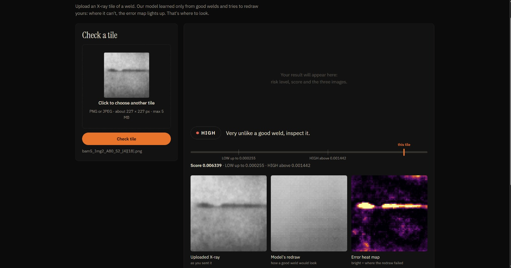
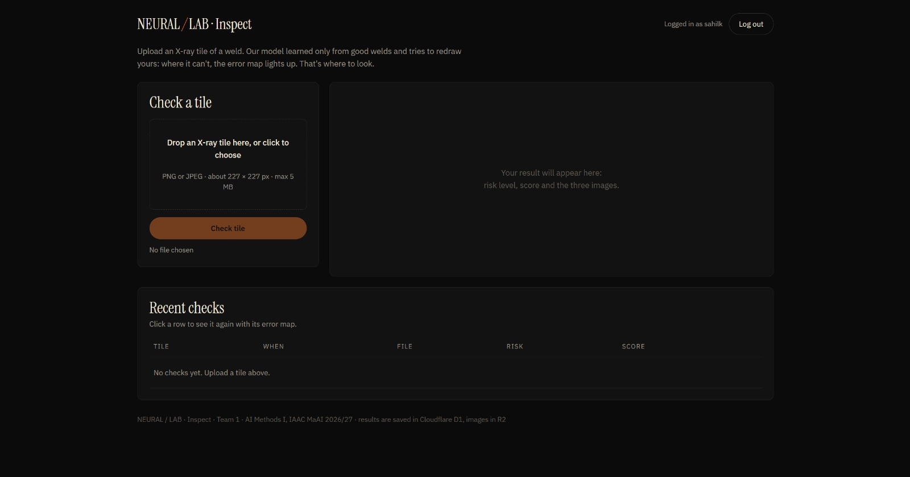
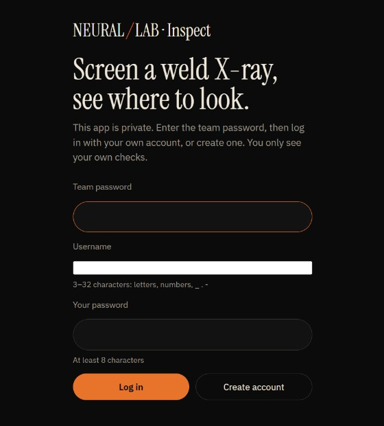

# 04_final · Proofs

Live app: **https://hackathon-team1-weld-app.pages.dev** (Cloudflare Pages). Commands run on 19 November 2026 against the live services.

## 1 · A database

```bash
npx wrangler d1 execute hackathon-team1-weld-db --remote --command "SELECT name FROM sqlite_master"
```

Output (names only; the full JSON also says `"success": true`, `"served_by_region": "WEUR"`):

```
_cf_KV
predictions
sqlite_autoindex_predictions_1
idx_predictions_created_at
users
sqlite_autoindex_users_1
sqlite_autoindex_users_2
idx_predictions_user
```

Two tables: `users` (one row per account) and `predictions` (one row per check, with its `user_id`). Schema: [`03_app/schema.sql`](../03_app/schema.sql).

## 2 · Locked on the server

Without logging in, the API answers **401** and no data:

```bash
curl -i https://hackathon-team1-weld-app.pages.dev/api/history
```

```
HTTP/1.1 401 Unauthorized
Content-Type: application/json
Server: cloudflare

{"error":"Not logged in"}
```

The same for an image (`/api/images/{id}` → `401 Unauthorized`); the page itself (`/`) redirects to the login page (`302 Found`). The check runs on the server, in [`03_app/functions/_middleware.js`](../03_app/functions/_middleware.js), before every request. The shared team password from Wednesday is still required for everyone, at every log-in and sign-up.

## 3 · Connected to Render

The `MODEL_URL` line in [`03_app/wrangler.toml`](../03_app/wrangler.toml):

```toml
MODEL_URL = "https://hackathon-team1-weld-anomaly.onrender.com/gradio"
```

A live result in the app (checked through our model server on Render): a lack-of-penetration tile scores **HIGH** (0.006339, above HIGH at 0.001442), and the error heat map lights up along the defect:



## 4 · No secrets in git

`.dev.vars` (the local password) is in `.gitignore` (root, line 29, and `03_app/.gitignore`), and no `.dev.vars` or `.env` file is tracked (`git ls-files` finds none).

We asked our AI tool (Claude Code): *"Check my repo and my Cloudflare account for secrets that are in code or in the git history."* What it ran and found:

| Check | Result |
|---|---|
| The team password in any tracked file (`git grep`) | not found |
| The team password anywhere in the git history (`git log --all -S`) | not found |
| The test accounts' passwords, files and history | not found |
| API keys and tokens in the history (Hugging Face `hf_…`, `sk-…`, GitHub `ghp_…`, AWS keys, Cloudflare API tokens, private keys) | not found |
| `APP_PASSWORD = …` with a real value in the history | not found (only the placeholder comment "put APP_PASSWORD=... in a .dev.vars file") |
| Cloudflare: `npx wrangler pages secret list --project-name hackathon-team1-weld-app` | `APP_PASSWORD: Value Encrypted`: the password is a Cloudflare secret, not in the code |

The account passwords are never stored anywhere: D1 keeps only a salted PBKDF2 hash (`pbkdf2$100000$<salt>$<hash>`).

## 5 · Login works (user accounts)

The login page asks for the team password, a username and the user's own password, with **Log in** and **Create account**:

**Sign up:** the login page, with the team password, a username, the user's own password and **Create account**:


**Logged in:** "Logged in as sahilk" at the top right; a new account starts with no checks of its own ("No checks yet"):



**Logged out:** after **Log out**, the browser is back on the login page:



The same, run against the live app with two test accounts (`test_a`, `test_b`; their passwords are in the course hand-in, not here):

```
sign up test_a           → 302 to /                       (account created, logged in)
sign up test_b           → 302 to /
GET /api/me  (test_a)    → {"username":"test_a"}
wrong team password      → 302 to /login?error=team       ("Wrong team password")
wrong user password      → 302 to /login?error=wrong      ("Wrong username or password")
```

Log out, then any `/api/…` request → 401 (tested on the local copy of the app, `wrangler pages dev`).

## 6 · Own data only

`test_a` checked one X-ray; `test_b` checked none. Live results:

```
test_a  GET /api/history                       → 1 row
test_b  GET /api/history                       → 0 rows   (does not see test_a's check)
test_b  GET /api/images/<test_a's check id>    → 404 Not found
```

How: every check is saved with the `user_id` from the session cookie; `/api/history` reads `WHERE user_id = ?`, and `/api/images/{id}` first checks in D1 that the check belongs to the logged-in user ([`history.js`](../03_app/functions/api/history.js), [`images/[id].js`](../03_app/functions/api/images/[id].js)). The session cookie is signed, so it can't be edited into another user's id (a forged cookie gets 401, tested on the local copy).
