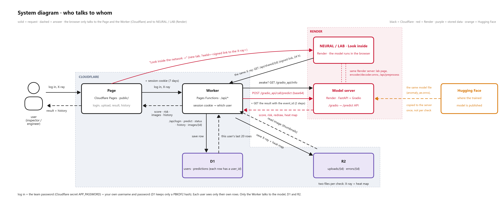
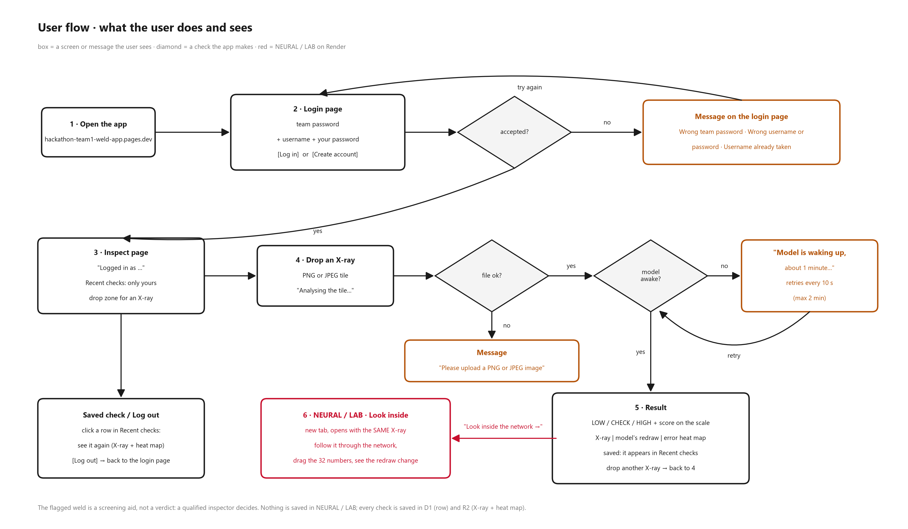
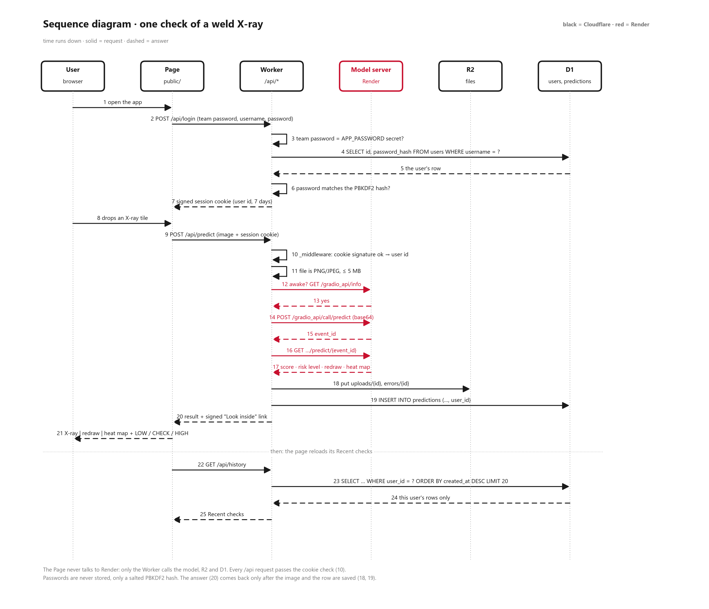
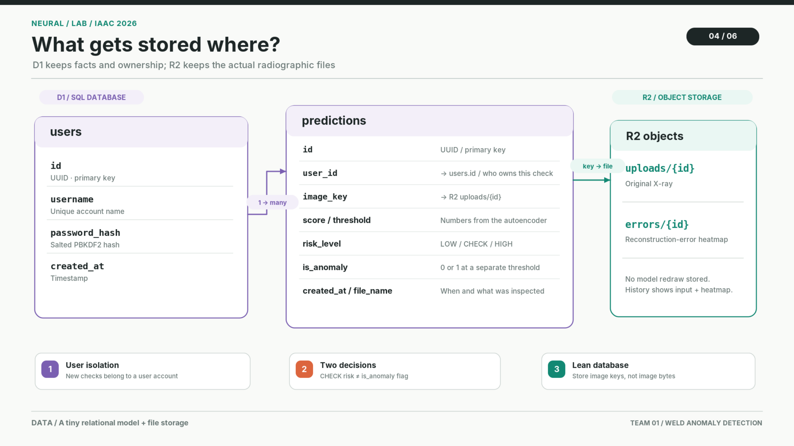
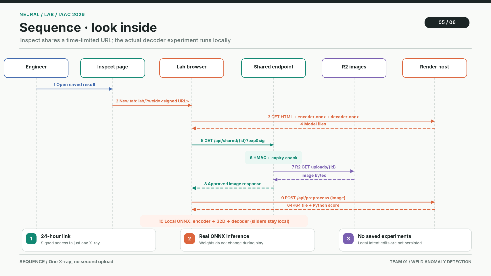
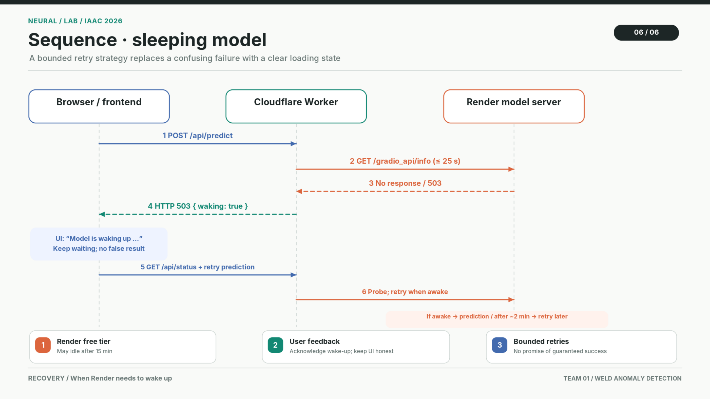

# 04_final · NEURAL / LAB: weld X-ray screening with an autoencoder

## Use case

A weld inspector uploads an X-ray tile of a steel weld. Our model, a convolutional autoencoder trained **only on sound welds**, tries to redraw it. Where it can't, there is probably a defect: the app shows a risk level (**LOW / CHECK / HIGH**), the score against the thresholds, and an error heat map that shows **where** to look. Every check is saved, so each inspector has a history of their own checks. An engineer can open the same X-ray in **NEURAL / LAB · Look inside** to see how the network handles it.

It is a screening aid, not a verdict: a qualified inspector decides.

## Live URLs

| Part | URL |
|---|---|
| **The app: NEURAL / LAB · Inspect** (Cloudflare Pages + D1 + R2; team password + own account) | **https://hackathon-team1-weld-app.pages.dev** |
| **Model server** (Render: FastAPI + Gradio, the `/predict` API) | https://hackathon-team1-weld-anomaly.onrender.com/gradio |
| **NEURAL / LAB · Look inside** (Render: the model runs in the browser) | https://hackathon-team1-weld-anomaly.onrender.com |
| **Model** (Hugging Face) | https://huggingface.co/iaac-maai/hackathon-team1-weld-anomaly-ae |

The team password and a test account are in the course hand-in, not in this repository. The Render server sleeps after 15 minutes; the first check after a pause takes about a minute (the app says so and retries by itself).

## How it works

1. The user logs in: the **team password** first, then their **own account** (username + password, stored only as a PBKDF2 hash).
2. They drop an X-ray. The **Worker** (Cloudflare Pages Functions) checks the session cookie and the file, asks the **model server on Render** whether it is awake, sends the X-ray and gets back the score, the risk level, the redraw and the heat map.
3. The Worker saves the X-ray and the heat map in **R2** and one row in **D1** (with the user's id), and answers the page.
4. Recent checks come back from D1, **only the user's own**.
5. "Look inside the network →" opens NEURAL / LAB with **the same X-ray**, through a signed link to it in R2 (valid 24 h).

**Where the data is, and what is persistent:**

| What | Where | Persistent? |
|---|---|---|
| Accounts (username, password hash) | D1, table `users` | yes |
| One row per check (score, risk level, file name, date, user) | D1, table `predictions` | yes |
| The X-ray and its heat map | R2, `uploads/{id}` and `errors/{id}` | yes |
| The team password | Cloudflare secret `APP_PASSWORD` | yes, encrypted |
| The trained model | Hugging Face, copied to the Render server | yes |
| What happens in NEURAL / LAB | the user's browser | no, nothing is saved |

Code: [`03_app/`](../03_app/) (the app), [`02_model_server/`](../02_model_server/) (Render), [`01_autoencoder/`](../01_autoencoder/) (the model). Proofs: [`PROOFS.md`](PROOFS.md).

## Diagrams

Every arrow is in the code (checked against `03_app/functions/`, `03_app/public/` and `02_model_server/`).

**System diagram:** the parts and how they connect.

**User flow:** what the user does and sees.

**Sequence diagram:** one check, in order.

**More diagrams:**

What is stored where (D1 tables and R2 files):

Sequence: "Look inside" opens the same X-ray through the signed link:

Sequence: the model server is asleep:

The design before building and the first version after building are in [`03_app/diagrams/`](../03_app/diagrams/).

## Presentation

The finals deck (11 slides, in the order the teachers asked for): [`presentation/NEURAL_LAB_finals_presentation_team1.pdf`](presentation/NEURAL_LAB_finals_presentation_team1.pdf). The figures made for the slides (the model figure and wider versions of diagrams 1–3, with transparent backgrounds) are in [`presentation/slide_images/`](presentation/slide_images/).

## Three statements

> ✍️ **Written by the team**, not by the AI.

### 1. What is clear?

We understand how an autoencoder can identify unusual patterns by learning to reconstruct defect-free welds. We successfully connected our trained model to a deployed application, linking Hugging Face, Render, Cloudflare, D1 and R2 into one workflow. Building NEURAL / LAB also helped us understand what happens inside the network, from convolutional feature maps to the 32-dimensional latent representation. We learned that a working AI product requires much more than a trained model: data preparation, backend communication, authentication, storage and user experience all need to work together.

### 2. What is still unclear?

Although our model achieved promising results on the RIAWELC dataset, we do not yet know how reliably it would perform on X-rays captured using different equipment or in real construction environments. We also cannot confidently explain what each individual latent neuron represents, even though we can observe how changing its value affects the reconstruction. Our synthetic defect experiments demonstrate the model's sensitivity, but they do not fully represent real radiographic defects. The error heatmaps highlight reconstruction differences, but we have not validated their accuracy for precise defect localisation.

### 3. What would we do next?

**First**, expand the dataset with radiographs from different welding processes and inspection environments to test generalisation.

**Second**, investigate the neural network's behaviour more deeply through controlled experiments, comparing different autoencoder architectures and measuring how reliably reconstruction errors correspond to actual defect locations.

**Third**, develop NEURAL / LAB into a more practical inspection tool by supporting full-size radiographs, improving the review workflow and allowing qualified inspectors to provide feedback on predictions.

## Limitations

- **Few welds:** the model was trained and tested on RIAWELC, 29 welds in total, 4 in the test set. "About 0.99 ROC AUC on unseen welds" is the fair claim.
- **One lab, one X-ray setup:** results may not transfer to other equipment or exposure settings.
- **Tiles, not whole X-rays:** the model expects a weld tile (227 × 227 px, shrunk to 64 × 64). A whole photo or a picture of something else usually scores high because it is unlike anything seen, not because of a defect. It is not a reliable "is this a weld?" check.
- **Screening aid, not a verdict:** acceptance under welding standards (e.g. ISO 5817) depends on defect size and plate thickness, which the dataset does not contain.
- **Free plans:** Render sleeps after 15 minutes (first check about a minute). Accounts have no password reset and no account deletion yet; checks saved before accounts existed have no owner and are not shown.
- **The signed "Look inside" link** opens one X-ray without the password for 24 hours, so whoever has the link can see that image.
